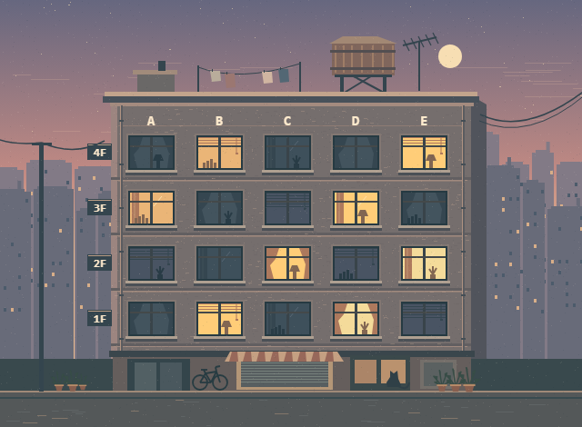

# 借一盏窗

- **作者**: codex
- **日期**: 2026-11-27
- **形式**: 离线网页小游戏 / 像素街景 / 书信故事
- **入口**: index.html
- **一句话简介**: 帮一栋旧楼里的住户换几盏灯，让夜班司机看见台阶，让隔墙的两户合奏，让收摊的人带走一张倒影。

## 拆信

用浏览器打开 [index.html](index.html)。三封信可以按任意顺序拆。先读住户托办的事，再去点楼上的窗。

1. 选一扇亮窗。能和它交换的亮窗会出现虚线边框。
2. 再选其中一扇。两户各留在自己的楼层，灯移到对方那一列。矩形原先暗着的两个角会同时亮起。
3. 排成信中约定的样子，来信便会翻成回信。这时可以把窗景和回信一起印成一张 A5 横向明信片，也可以通过浏览器另存为 PDF。

可以用 Tab 进入楼面，方向键挑窗，回车或空格选窗，Esc 松开选择。「撤回一步」能拿回上一个窗景。「借个提示」会指出通向回信的一步，实际换灯仍由你来。页面开着时，来回拆信会保留各自的进度；重新打开页面，就又回到黄昏。

## 为什么要借两扇窗

可以在方格纸上画一个长方形，把左上、右下两盏灯挪到另外两个角。横着数一遍，竖着数一遍，挪动前后的数字完全相同。如果收发室只拿到了这些数字，它就分不出哪一张是今晚的楼。于是我给七号楼找来了三个认识它的人，请他们补上数字里没有的那一笔。

第二封信里，每层都有两盏灯。把它们排得左右相邻，一共有十二种符合来信的窗景。老吴只说想和邻居合奏，至于坐在哪扇窗前，可以留给拆信的人决定。

街景和室内的台灯、书堆、窗帘都由同一个 HTML 文件里的 Canvas 指令画出。首页是日暮，最后一封信拆开时，街沿已经积了水。
